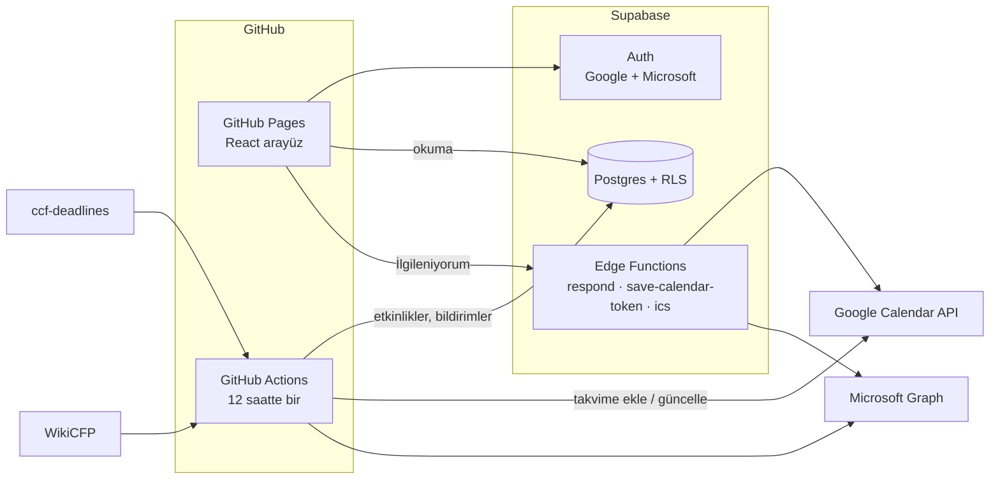

# 📅 CFP Takvim

Bilgisayar mühendisliği ve elektrik-elektronik mühendisliği alanındaki **konferans, çalıştay ve dergi özel sayısı çağrılarının** başvuru tarihlerini toplayan, ilgilendiklerinizi **Google veya Outlook takviminize otomatik ekleyen** web sitesi.

**Site:** https://safaksahinn.github.io/cfp-takvim/

## Özellikler

- 🔐 **Google / Microsoft ile tek tıkla giriş**: ilk girişte hesap otomatik açılır. Site yalnızca üyelere açıktır.
- 🔄 **12 saatte bir güncellenen veri**: ccf-deadlines ve WikiCFP kaynaklarından birleştirilir. Son tarihler saat dilimine (AoE, UTC±N) göre doğru çevrilir.
- ⭐ **Takip**: Takip ettiğiniz çağrı için başvuru açıldığında takviminize **başvuru başlangıcı** ve **son başvuru** (7 gün ve 1 gün önce hatırlatıcıyla) eklenir.
- ✉️ **Site içi mesajlar**: Seçtiğiniz konularda yeni çağrı çıktığında "İlgileniyor musunuz?" mesajı gelir. **İlgileniyorum** derseniz başvuru tarihleri ve **konferans günlerinin tamamı** takviminize eklenir.
- 🔁 **Tarih uzatmaları**: Son tarih değişirse takvimdeki kayıt güncellenir ve size mesaj gelir.
- 📆 **ICS aboneliği**: Takvim izni vermek istemeyenler veya Apple Takvim kullananlar için kişiye özel abonelik adresi.
- 🌐 Türkçe ve İngilizce arayüz.

## Mimari

GitHub Pages yalnızca statik dosya sunabildiği için üyelik, veritabanı ve gizli anahtarlar Supabase'te tutulur (ücretsiz katman yeterli). Zamanlanmış işlerin hepsi GitHub Actions'ta çalışır.

| Klasör | İçerik |
|---|---|
| `web/` | React + Vite arayüzü (GitHub Pages) |
| `jobs/` | Veri çekme (`fetch`) ve bildirim/takvim dağıtımı (`dispatch`), Node.js |
| `supabase/migrations/` | Veritabanı şeması, RLS politikaları |
| `supabase/functions/` | Edge Functions + ortak takvim/şifreleme kodu (`_shared/`, jobs ile paylaşılır) |
| `shared/` | Konu sınıflandırması (arayüz + jobs) |
| `.github/workflows/` | 12 saatlik iş, site ve Supabase yayınlama |

## Kurulum

Adım adım rehber: **[docs/KURULUM.md](docs/KURULUM.md)**

## Bilinen sınırlar / yol haritası

- **Kaynaklar:** IEEE'nin resmi konferans arama sitesi, MDPI ve Elsevier otomatik erişimi engelliyor (HTTP 403/418). Bu yayıncıların IEEE etiketli konferansları ve dergi çağrılarının önemli kısmı WikiCFP üzerinden geliyor. Doğrudan entegrasyon ileride eklenecek.
- **Başvuru başlangıç tarihi:** Kaynakların çoğu yalnızca son tarihi yayınlıyor. Başlangıç tarihi yoksa çağrının ilk görüldüğü gün "başvuru açıldı" kabul edilir.
- **Google doğrulaması:** Takvim izni hassas kapsam (sensitive scope) olduğu için, Google doğrulaması tamamlanana kadar takvim bağlama en fazla 100 test kullanıcısıyla sınırlı.
- WikiCFP'de düşük kaliteli ("predatory") konferanslar da listelenebiliyor. Filtrelerdeki "Sadece IEEE" ve "Sadece dereceli" seçenekleri bu konuda yardımcı olur.
