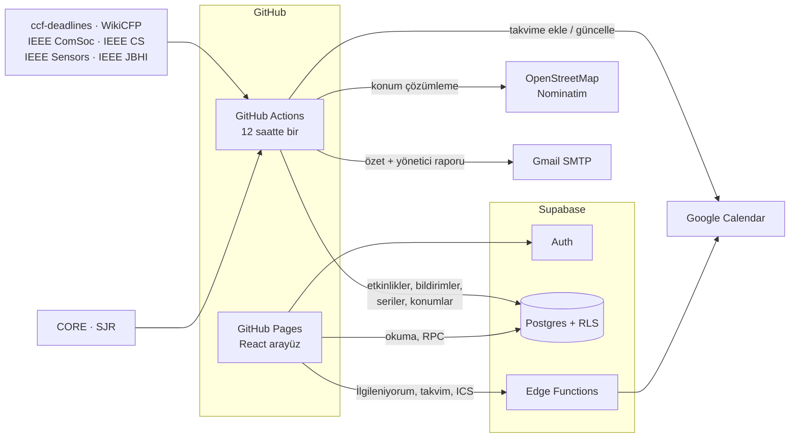

# CFP Calendar

Bilgisayar mühendisliği ve elektrik-elektronik mühendisliği alanındaki **konferans, çalıştay ve dergi özel sayısı çağrılarını** tek yerde toplayan, takip ettiklerinizi **Google takviminize otomatik ekleyen** ve araştırma gruplarının başvurularını birlikte izlemesini sağlayan web sitesi.

**Site:** https://safaksahinn.github.io/cfp-calendar/

> Site yalnızca üyelere açıktır; kişisel bilgiler ve grup içerikleri herkese açık değildir.

## Özellikler

### Çağrılar
- 🔄 **12 saatte bir güncellenen veri:** ccf-deadlines, WikiCFP, IEEE ComSoc, IEEE Computer Society, IEEE Sensors Journal ve IEEE JBHI kaynaklarından birleştirilir. Son tarihler saat dilimine (AoE, UTC±N) göre doğru çevrilir; özet (abstract) son tarihleri ayrıca gösterilir.
- 🏅 **Dereceler:** CCF, CORE (ICORE2026) konferans dereceleri ve SCImago (SJR 2025) dergi çeyrekleri.
- ⚠️ **Kalite işaretleri:** İndeksleme vaadi, organizatör öneki gibi şüpheli ("predatory") çağrı kalıpları işaretlenir ve varsayılan olarak gizlenir.
- 🔎 **Filtreler:** Alan, tür, konu, tarih aralığı, yüz yüze / çevrim içi, Türkiye'de, sadece IEEE, sadece dereceli, Q1–Q2 dergiler, TÜBİTAK başvurusu açık; sıralama seçenekleri.
- 🗂️ **Üç görünüm:** Liste, aylık takvim ve 🗺️ **harita** (etkinlik şehirleri OpenStreetMap ile konumlandırılır).
- 📄 **Çağrı sayfası:** Önemli tarihler çizelgesi, resmi site bağlantısı, paylaşma, hata bildirme, **benzer çağrılar**.
- 🔁 **Konferans serileri:** Serinin önceki yıllarının son tarihleri görünür. "Seriyi takip et" denirse gelecek yılın çağrısı yayımlanınca otomatik takibe alınır ve mesaj gelir.
- 💰 **TÜBİTAK 2224-A/B:** Her konferans için hangi destek döneminde başvurulması gerektiği hesaplanır.

### Takvim ve bildirimler
- 🔐 **Giriş:** Google veya e-posta + şifre (Microsoft girişi hazır, kurulum bekliyor).
- ⭐ **Takip:** Takip edilen çağrının başvurusu açıldığında takvime **başvuru başlangıcı**, **özet** ve **son başvuru** kayıtları eklenir. Tarih uzatılırsa kayıt güncellenir.
- ✉️ **Site içi mesajlar:** Seçtiğiniz konularda yeni çağrı çıkınca "İlgileniyor musunuz?" sorulur. **İlgileniyorum** derseniz konferans günlerinin tamamı da takvime eklenir.
- 📆 **Takvimim** sayfası ve **ICS aboneliği** (Apple Takvim, Outlook vb. için kişiye özel adres).
- 📧 İsteğe bağlı haftalık / anında e-posta özeti.

### Araştırma grupları
- 👥 **Lab grupları:** Davet bağlantısıyla katılım, ortak grup takvimi (ICS dahil), gruba çağrı önerme.
- 📝 **Başvuru takibi:** Planlanıyor → Gönderildi → Değerlendirmede → Kabul/Ret. Danışman (grup sahibi) paylaşılan başvuruları görür; kişisel notlar asla paylaşılmaz.
- 🙋 **Grupta kim başvuruyor:** Kişi izin verirse grup arkadaşları onun yalnızca adını ve başvuru durumunu görür.

### Diğer
- 🌐 Türkçe / İngilizce arayüz, 🌙 karanlık / ☀️ aydınlık mod.
- 📱 Telefona kurulabilir uygulama (PWA).
- 🛠️ **Yönetici paneli:** Özet ve sistem durumu, bakım hatırlatmaları, üyeler, geri bildirimler, elle etkinlik ekleme, duyurular, işlem kaydı. Yöneticiye günlük durum raporu e-postası.
- ⚖️ KVKK aydınlatma metni, kullanım koşulları, hesabı ve verileri silme.

## Mimari

GitHub Pages yalnızca statik dosya sunduğu için üyelik, veritabanı ve gizli anahtarlar Supabase'te tutulur. Tüm yetki kontrolleri veritabanında (Row Level Security + `SECURITY DEFINER` fonksiyonlar) yapılır; takvim erişim anahtarları AES-256-GCM ile şifrelenir. Proje tamamen ücretsiz katmanlarda çalışır.

| Klasör | İçerik |
|---|---|
| `web/` | React 19 + Vite + TypeScript arayüzü (GitHub Pages) |
| `jobs/` | Veri çekme, birleştirme, derecelendirme, konum çözümleme, bildirim/takvim dağıtımı, e-postalar (Node.js) |
| `jobs/src/sources/` | Kaynak ayrıştırıcıları (ccf, WikiCFP, ComSoc, IEEE dergileri) |
| `supabase/migrations/` | Veritabanı şeması, RLS politikaları, RPC'ler |
| `supabase/functions/` | Edge Functions (`respond`, `save-calendar-token`, `ics`, `unsubscribe`, `delete-account`) ve ortak takvim/şifreleme kodu |
| `shared/` | Konu sınıflandırması ve TÜBİTAK dönemleri (arayüz + jobs) |
| `.github/workflows/` | 12 saatlik veri işi, site ve Supabase yayınlama, testler |

## Testler

| Test | Kapsam |
|---|---|
| `jobs/test` (birim) | Kaynak ayrıştırıcıları, tarih/saat dilimi, birleştirme, CORE/SJR eşleştirme, kalite işaretleri, TÜBİTAK, e-posta şablonları |
| `jobs/e2e` (`e2e.yml`) | Canlı veritabanında geçici kullanıcılarla yetki ve gizlilik kontrolleri: RLS, gruplar, başvurular, duyurular, seriler |
| `jobs/e2e/ui.ts` (`ui-test.yml`) | Playwright ile masaüstü ve iPhone görünümünde uçtan uca arayüz testleri, ekran görüntüleriyle |

## Kurulum

Adım adım rehber: **[docs/KURULUM.md](docs/KURULUM.md)**

## Bilinen sınırlar

- **Kaynaklar:** IEEE'nin resmi konferans arama sitesi, MDPI, Elsevier ve Springer otomatik erişimi engelliyor. Bu yayıncıların çağrılarının önemli kısmı WikiCFP üzerinden geliyor.
- **Başvuru başlangıç tarihi:** Kaynakların çoğu yalnızca son tarihi yayınlıyor. Başlangıç tarihi yoksa çağrının ilk görüldüğü gün "başvuru açıldı" kabul edilir.
- **Google doğrulaması:** Takvim izni hassas kapsam olduğu için, Google doğrulaması tamamlanana kadar takvim bağlama en fazla 100 kullanıcıyla sınırlı.
- **Konumlar yaklaşıktır:** Harita konumları etkinlik yeri metninden otomatik çıkarılır.
- Tarihleri her zaman resmi çağrı sayfasından doğrulayın.
