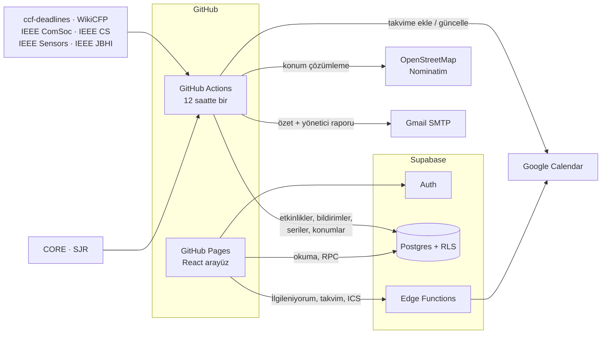

# Mimari

CFP Calendar'ın nasıl çalıştığı, klasör yapısı, testler ve bilinen sınırlar. Kurulum için [KURULUM.md](KURULUM.md), bakım işleri için [BAKIM.md](BAKIM.md).

## Genel yapı

GitHub Pages yalnızca statik dosya sunduğu için üyelik, veritabanı ve gizli anahtarlar Supabase'te tutulur. Tüm yetki kontrolleri veritabanında (Row Level Security + `SECURITY DEFINER` fonksiyonlar) yapılır; takvim erişim anahtarları AES-256-GCM ile şifrelenir. Proje tamamen ücretsiz katmanlarda çalışır.

| Klasör | İçerik |
|---|---|
| `web/` | React 19 + Vite + TypeScript arayüzü (GitHub Pages) |
| `jobs/` | Veri çekme, birleştirme, derecelendirme, konum çözümleme, bildirim/takvim dağıtımı, e-postalar (Node.js) |
| `jobs/src/sources/` | Kaynak ayrıştırıcıları (ccf, WikiCFP, ComSoc, IEEE dergileri) |
| `supabase/migrations/` | Veritabanı şeması, RLS politikaları, RPC'ler |
| `supabase/functions/` | Edge Functions (`respond`, `save-calendar-token`, `ics`, `unsubscribe`, `delete-account`) ve ortak takvim/şifreleme kodu |
| `shared/` | Konu sınıflandırması ve TÜBİTAK dönemleri (arayüz + jobs) |
| `.github/workflows/` | 12 saatlik veri işi, site ve Supabase yayınlama, testler |

## Testler

| Test | Kapsam |
|---|---|
| `jobs/test` (birim) | Kaynak ayrıştırıcıları, tarih/saat dilimi, birleştirme, CORE/SJR eşleştirme, kalite işaretleri, TÜBİTAK, e-posta şablonları |
| `jobs/e2e` (`e2e.yml`) | Canlı veritabanında geçici kullanıcılarla yetki ve gizlilik kontrolleri: RLS, gruplar, başvurular, duyurular, seriler |
| `jobs/e2e/ui.ts` (`ui-test.yml`) | Playwright ile masaüstü ve iPhone görünümünde uçtan uca arayüz testleri, ekran görüntüleriyle |

## Kurulum

Adım adım rehber: **[KURULUM.md](KURULUM.md)**

## Bilinen sınırlar

- **Kaynaklar:** IEEE'nin resmi konferans arama sitesi, MDPI, Elsevier ve Springer otomatik erişimi engelliyor. Bu yayıncıların çağrılarının önemli kısmı WikiCFP üzerinden geliyor.
- **Başvuru başlangıç tarihi:** Kaynakların çoğu yalnızca son tarihi yayınlıyor. Başlangıç tarihi yoksa çağrının ilk görüldüğü gün "başvuru açıldı" kabul edilir.
- **Google doğrulaması:** Takvim izni hassas kapsam olduğu için, Google doğrulaması tamamlanana kadar takvim bağlama en fazla 100 kullanıcıyla sınırlı.
- **Konumlar yaklaşıktır:** Harita konumları etkinlik yeri metninden otomatik çıkarılır.
- Tarihleri her zaman resmi çağrı sayfasından doğrulayın.
