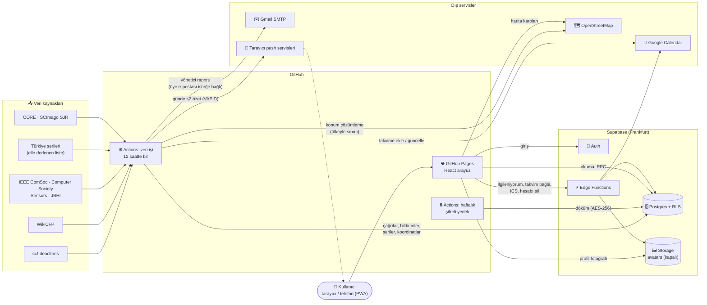
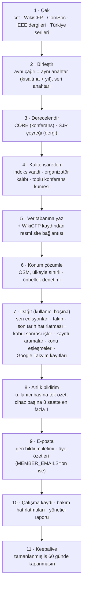
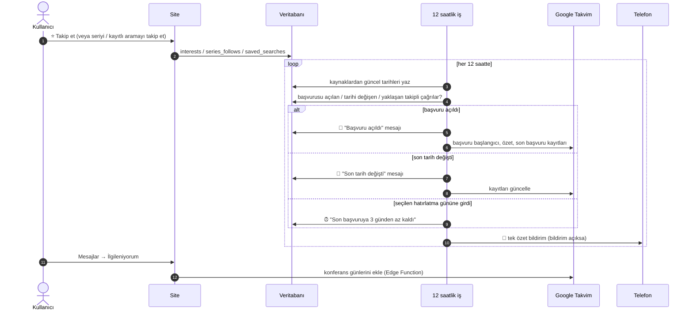
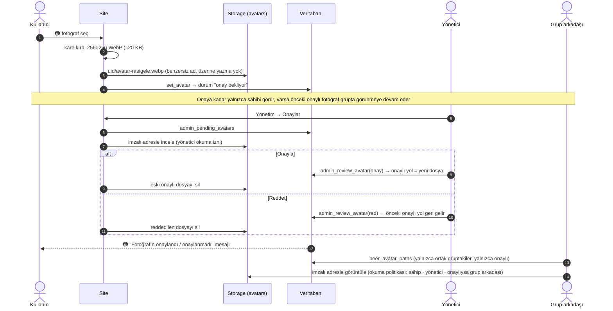

# Mimari

CFP Calendar'ın nasıl çalıştığı, veri modeli, güvenlik ilkeleri, klasör yapısı, testler ve bilinen sınırlar. Kurulum için [KURULUM.md](KURULUM.md), bakım işleri için [BAKIM.md](BAKIM.md).

## Genel yapı

GitHub Pages yalnızca statik dosya sunduğu için üyelik, veritabanı, dosyalar ve gizli anahtarlar Supabase'te tutulur. Tüm yetki kontrolleri veritabanında yapılır (bkz. [Güvenlik ilkeleri](#güvenlik-ilkeleri)). Proje tamamen ücretsiz katmanlarda çalışır.

### 12 saatlik veri işi (`sync.yml` → `jobs/src/main.ts`)

Her adım hata verse de sonraki adımlar mümkün olduğunca çalışır. Kaynaklardan biri düşerse diğerleri devam eder ve çalışma kaydına "HATA" yazılır. Adımlar `sync.yml` üzerinden tek tek de çalıştırılabilir (`fetch`, `geocode`, `dispatch`, `push`, `push-test`, `email`).

### Bir çağrıyı takip edince ne olur?

### Profil fotoğrafı ve onay

## Veri modeli (özet)

| Alan | Tablolar | Not |
|---|---|---|
| Çağrılar | `events` | Kaynaklardan birleştirilmiş çağrılar; `ranks`, `flags` (kalite), `series_key`, `lat/lng`, `source_url` |
| Kullanıcı | `profiles`, `admins` | Unvan, kurum, dil, bildirim tercihleri, `reminder_days`, fotoğraf yolu ve onay durumu |
| İlgi | `interests`, `series_follows`, `saved_searches` | Takip edilen çağrılar ve konular; takip edilen seriler; kayıtlı aramalar (en fazla 10) |
| Mesajlar | `notifications`, `announcements` | Site içi mesajlar (`emailed_at`, `pushed_at`), yönetici duyuruları |
| Takvim | `calendar_connections`, `calendar_entries` | Şifreli erişim anahtarları; eklenen kayıtlar ve özetleri (değişince güncellenir) |
| Gruplar | `groups`, `group_members`, `group_events`, `group_comments` | Ortak takvim, öneriler, yorumlar |
| Başvurular | `submissions`, `submission_members` | Durum, kabul sonrası tarihler, ortak notlar; ortak yazarlar |
| Cihazlar | `push_subscriptions` | Web Push abonelikleri (cihaz başına) |
| Sistem | `sync_runs`, `app_state`, `admin_audit`, `geocache`, `feedback` | Çalışma kayıtları, bakım durumu, yönetici işlem kaydı, konum önbelleği |
| Dosyalar | Storage `avatars` | Herkese kapalı; 100 KB, yalnızca resim |

## Güvenlik ilkeleri

- **Her tabloda Row Level Security.** Kullanıcı yalnızca kendi satırlarını okur ve yazar. Paylaşılan veriler (grup üye listesi, danışman görünümü, ortak yazar görünümü, istatistikler) `SECURITY DEFINER` RPC'lerle ve yalnızca gereken sütunlarla döner; e-posta adresi başka üyelere hiçbir yerde dönmez.
- **Sütun izinleri:** Gizli sütunlar (grup ve başvuru davet kodları, fotoğraf onay durumu, geri bildirim durumu) istemciden okunamaz ve yazılamaz; yalnızca RPC'lerle değişir. Bu yüzden bu tablolarda `select('*')` kullanılmaz; okunacak sütunlar açıkça yazılır.
- **Depo (Storage):** `avatars` herkese kapalıdır. Okuma: sahibi, yöneticiler ve fotoğraf onaylıysa ortak grubu olan üyeler (`can_read_avatar`). Yazma: yalnızca kendi klasörü ve benzersiz dosya adı.
- **Kötüye kullanım sınırları:** Günde 20 geri bildirim, günde 30 grup yorumu, kişi başı 10 grup / 10 kayıtlı arama, grup başı 200 üye, başvuru başı 20 ortak yazar.
- **Gizli anahtarlar:** Takvim anahtarları AES-256-GCM ile şifreli. VAPID ve yedek şifresi yalnızca GitHub secret'larında. Haftalık yedek yüklenmeden önce AES-256 ile şifrelenir ve CI'da çözülüp doğrulanır.
- **Bildirim yoğunluğu:** Telefon bildirimi kullanıcı başına tek özet ve cihaz başına 8 saatte en fazla 1 (günde ≤2). Yorum ve ortak yazar güncellemeleri günde 1 mesajla sınırlı.

## Klasörler

| Klasör | İçerik |
|---|---|
| `web/` | React 19 + Vite + TypeScript arayüzü (GitHub Pages, PWA; ikincil sayfalar ve harita ihtiyaç anında yüklenir; açık çağrı listesi tarayıcıda saklanıp açılışta anında gösterilir, arka planda yenilenir) |
| `web/public/sw.js` | Service worker: kabuk önbelleği, push bildirimi gösterme ve tıklama |
| `jobs/src/` | 12 saatlik iş: `fetch`, `merge`, `quality`, `core`, `sjr`, `geocode`, `dispatch`, `reminders`, `savedSearches`, `push`, `email`, `maintenance`, `adminReport` |
| `jobs/src/sources/` | Kaynak ayrıştırıcıları: `ccf`, `wikicfp`, `comsoc`, `ieeejournals`, `turkiye` |
| `shared/` | Site ve iş tarafında ortak: konular (`topics`), TÜBİTAK dönemleri (`tubitak`), Türkiye serileri (`turkiye`), filtre kuralları (`filters`), dikkat işaretleri (`caution`) |
| `supabase/migrations/` | Veritabanı şeması, RLS ve depo politikaları, RPC'ler, tetikleyiciler |
| `supabase/functions/` | Edge Functions: `respond`, `save-calendar-token`, `ics`, `unsubscribe`, `delete-account` (fotoğrafı da siler); ortak takvim ve şifreleme kodu `_shared/` |
| `.github/workflows/` | `sync` (12 saatlik iş + keepalive), `backup` (haftalık şifreli yedek), `deploy-web`, `deploy-supabase`, `e2e`, `ui-test` |

## Testler

| Test | Kapsam |
|---|---|
| `jobs/test` (birim) | Kaynak ayrıştırıcıları, tarih/saat dilimi, birleştirme, CORE/SJR eşleştirme, kalite işaretleri ve toplu konferans kümeleri, TÜBİTAK, Türkiye serileri, konum/ülke tanıma, hatırlatma eşikleri, kayıtlı aramalar, "Senin için", dışa aktarma, push ve e-posta metinleri |
| `jobs/e2e` (`e2e.yml`) | Canlı veritabanında geçici kullanıcılarla yetki ve gizlilik kontrolleri: RLS, gruplar, yorumlar, başvurular ve ortak yazarlar, duyurular, seriler, kayıtlı aramalar, push abonelikleri, fotoğraf deposu ve onay akışı, yönetici yetkileri, hesap silme |
| `jobs/e2e/ui.ts` (`ui-test.yml`) | Playwright ile masaüstü ve iPhone görünümünde uçtan uca arayüz testleri, ekran görüntüleriyle |

## Kurulum

Adım adım rehber: **[KURULUM.md](KURULUM.md)**

## Bilinen sınırlar

- **Kaynaklar:** IEEE'nin resmi konferans arama sitesi, MDPI, Elsevier ve Springer otomatik erişimi engelliyor; bu yayıncıların çağrılarının önemli kısmı WikiCFP üzerinden geliyor. Türkiye konferansları bu kaynaklarda çoğunlukla yok; `shared/turkiye.ts` elle güncellenir.
- **Başvuru başlangıç tarihi:** Kaynakların çoğu yalnızca son tarihi yayınlıyor. Başlangıç tarihi yoksa çağrının ilk görüldüğü gün "başvuru açıldı" kabul edilir.
- **Google doğrulaması:** Takvim izni hassas kapsam olduğu için, Google doğrulaması tamamlanana kadar takvim bağlama en fazla 100 kullanıcıyla sınırlı.
- **Bildirimler anlık değil:** Mesajlar ve telefon bildirimleri 12 saatlik işle gider.
- **Kalite işaretleri sezgiseldir:** Toplu konferans kuralı meşru bir çatı konferansı yanlışlıkla işaretleyebilir; muaf listesi `REPUTABLE_UMBRELLA` (`jobs/src/quality.ts`).
- **Konumlar yaklaşıktır:** Harita konumları etkinlik yeri metninden otomatik çıkarılır; ülke tutmazsa konum kullanılmaz.
- **Google profil fotoğrafı** onaydan geçmediği için yalnızca sahibine gösterilir; gruplarda yalnızca yüklenip onaylanan fotoğraf görünür.
- Tarihleri her zaman resmi çağrı sayfasından doğrulayın.
